  

  

  

<h3 align="center">Stack</h3>

  
  
  
  
  

  
  
  
  

  
  
  

  
  
  
  
  

  

<h3 align="center">Proyecto destacado</h3>

  

  

<h3 align="center">GitHub</h3>

  
  

  

  

<h3 align="center">Contacto</h3>

  
  
  

