  

  

<h3 align="center">Idiomas</h3>

<table align="center">
  <tr>
    <td align="center" width="200"> <b>Inglés</b> B2</td>
    <td align="center" width="200"> <b>Español</b> Nativo</td>
  </tr>
</table>

<h3 align="center">Lenguajes</h3>

<table align="center">
  <tr>
    <td align="center" width="130"> <b>Java</b></td>
    <td align="center" width="130"> <b>PHP</b></td>
    <td align="center" width="130"> <b>Go</b></td>
    <td align="center" width="130"> <b>JavaScript</b></td>
    <td align="center" width="130"> <b>TypeScript</b></td>
    <td align="center" width="130"> <b>Python</b></td>
  </tr>
</table>

<h3 align="center">Frameworks</h3>

<table align="center">
  <tr>
    <td align="center" width="130"> <b>Spring Boot</b></td>
    <td align="center" width="130"> <b>JUnit</b></td>
    <td align="center" width="130"> <b>FastAPI</b></td>
  </tr>
</table>

<h3 align="center">Bases de datos</h3>

<table align="center">
  <tr>
    <td align="center" width="130"> <b>MySQL</b></td>
    <td align="center" width="130"> <b>PostgreSQL</b></td>
    <td align="center" width="130"> <b>MongoDB</b></td>
  </tr>
</table>

<h3 align="center">DevOps y herramientas</h3>

<table align="center">
  <tr>
    <td align="center" width="130"> <b>Docker</b></td>
    <td align="center" width="130"> <b>Kubernetes</b></td>
    <td align="center" width="130"> <b>Maven</b></td>
    <td align="center" width="130"> <b>Postman</b></td>
    <td align="center" width="130"> <b>Git</b></td>
  </tr>
</table>

<h3 align="center">Sistemas operativos</h3>

<table align="center">
  <tr>
    <td align="center" width="110"> <b>Linux</b></td>
    <td align="center" width="110"> <b>Arch</b></td>
    <td align="center" width="110"> <b>Debian</b></td>
    <td align="center" width="110"> <b>Ubuntu</b></td>
    <td align="center" width="110"> <b>Red Hat</b></td>
  </tr>
</table>

  

<h3 align="center">Proyecto destacado</h3>

  

  

<h3 align="center">GitHub</h3>

  
  

  

  

<h3 align="center">Contacto</h3>

<table align="center">
  <tr>
    <td align="center" width="160"><a href="mailto:rivasgamoantonio@gmail.com"> <b>Email</b></a></td>
    <td align="center" width="160"><a href="https://www.linkedin.com/in/antoniorivasgamo/"> <b>LinkedIn</b></a></td>
    <td align="center" width="160"><a href="https://github.com/AntonioRivasGamo"> <b>GitHub</b></a></td>
  </tr>
</table>
